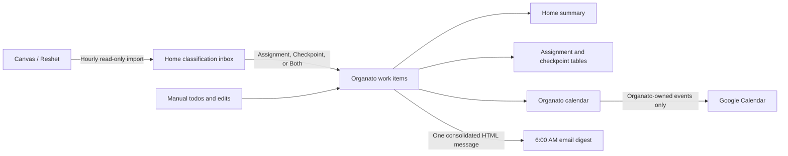

# Organato

Organato is a private, free-to-run school workload organizer for one person. It collects upcoming work from Canvas (called Reshet at school), asks the user to classify each new item as an assignment, checkpoint, or both, and brings school work, personal todos, a calendar, Google Calendar synchronization, and email reminders into one minimal interface.

The product should feel closer to Obsidian than a conventional school portal: black, quiet, keyboard-friendly, information-dense, and deliberately free of clutter.

## Non-negotiable constraints

1. Every required service, library, API, deployment target, and development tool must be usable without payment.
2. Setup must not require a credit card.
3. The product must not rely on an expiring free trial.
4. Application libraries must be open source.
5. Organato is private. Only explicitly allow-listed Google accounts can sign in.
6. There is one shared Organato workspace, even if the owner permits more than one of their Google accounts.
7. Desktop is the primary experience. Phone and tablet layouts remain usable and installable as a PWA.
8. Offline mode is intentionally out of scope.

## Product in one sentence

Open Organato and immediately know what needs attention, when it is due, and what to do next—without manually copying upcoming Canvas work into another system.

## Documentation map

| Document                                                              | Purpose                                                                                      |
| --------------------------------------------------------------------- | -------------------------------------------------------------------------------------------- |
| [Product specification](docs/01-product-specification.md)             | Goals, users, terminology, functional requirements, rules, and scope                         |
| [Experience and interface](docs/02-experience-and-interface.md)       | Navigation, every screen, responsive behaviour, interactions, and visual system              |
| [Data and behaviour](docs/03-data-and-behaviour.md)                   | Data model, lifecycle states, computed values, history, archives, and backups                |
| [Integrations and automation](docs/04-integrations-and-automation.md) | Canvas import, Google Calendar ownership, Gmail digests, schedules, and conflicts            |
| [Architecture and free stack](docs/05-architecture-and-free-stack.md) | Proposed implementation, hosting, free-tier guardrails, repository shape, and observability  |
| [Security and privacy](docs/06-security-and-privacy.md)               | Authentication, authorization, encryption, threat model, token handling, and recovery        |
| [Settings catalogue](docs/07-settings-catalogue.md)                   | Full settings information architecture and defaults                                          |
| [Delivery and quality plan](docs/08-delivery-and-quality-plan.md)     | Phases, acceptance criteria, testing, rollout, risks, and future ideas                       |
| [Decision register](docs/09-decision-register.md)                     | Confirmed decisions, inferred decisions, assumptions, and information still needed           |
| [Build and release runbook](docs/10-build-and-release-runbook.md)     | Local setup, provider configuration, scheduler decision, quality gates, deployment, recovery |

## Implemented architecture

The production-ready repository contains:

- React, TypeScript, and Vite for the PWA.
- A Cloudflare Worker for the authenticated API and scheduled jobs.
- Cloudflare D1 for the small relational database.
- A free local `launchd` scheduler for hourly Canvas checks and the 6:00 AM Sydney digest.
- Google OpenID Connect for sign-in.
- Google Calendar API for a dedicated `Organato` calendar.
- Gmail API for HTML email sent from the connected Google account to itself.
- Canvas REST API with a personal access token.

Cloudflare Cron remains disabled because the conservative 480-assignment benchmark exceeded the Workers Free 10 ms CPU allowance. The runbook records the evidence and the threshold required before reconsidering it.

This stack is deliberately replaceable. All Organato data can be exported, external identifiers are retained, and integration boundaries are isolated so a free service can be swapped out if its terms change.

## Core workflow

## Success looks like

- No upcoming Canvas assignment is missed because it was not copied manually.
- New Canvas work becomes visible after the next hourly sync.
- Classification happens from Home without interrupting the import.
- A single daily email contains all relevant reminders instead of generating notification spam.
- Manual edits survive later Canvas updates.
- Direct edits to Organato-created Google Calendar events are respected.
- Completed and submitted items no longer produce reminders.
- Archived work is hidden from normal views but recoverable from Settings.
- Normal personal usage stays far below every free-tier ceiling.

## Configuration still required

Deployment requires the exact Canvas base URL, permitted Google owner emails, OAuth credentials, D1 ID, and generated encryption/session/scheduler secrets. Canvas credentials are entered through the protected Settings flow; deployment secrets use Wrangler's secret store. None belong in Git.

For local development, run `pnpm install`, then `pnpm dev:web`. See the [build and release runbook](docs/10-build-and-release-runbook.md) for production configuration and the full `pnpm check` quality gate.
