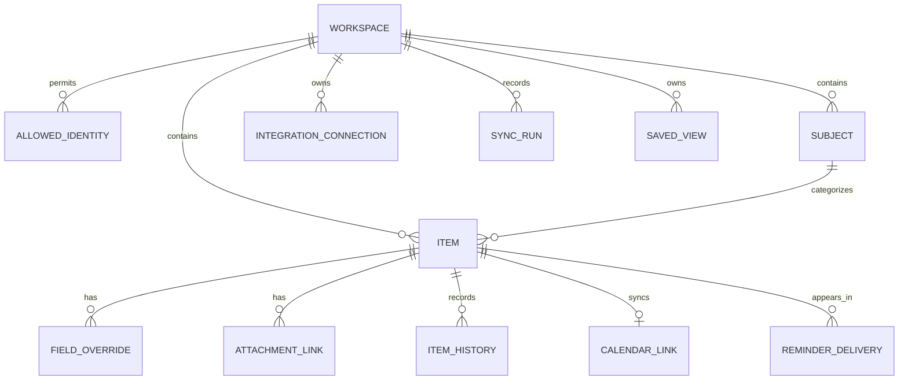
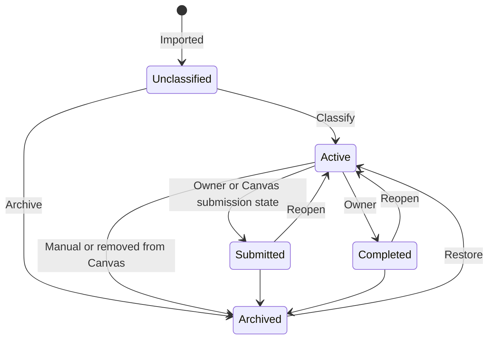

# Organato data and behaviour

## 1. Modelling principles

1. One real-world deadline is one underlying record.
2. A record may appear in multiple views without being duplicated.
3. Source data and user overrides are stored separately.
4. External identifiers are never treated as display text.
5. Archiving is the normal form of removal.
6. Computed values such as days remaining are calculated from dates, not stored as truth.
7. Every external write is idempotent.
8. Important state changes are reversible or recorded.

## 2. Entity overview



## 3. Core entities

### `workspace`

There is one row in normal use.

| Field                      | Purpose                                     |
| -------------------------- | ------------------------------------------- |
| `id`                       | Stable internal ID                          |
| `name`                     | `Organato` by default                       |
| `timezone`                 | IANA zone; default `Australia/Sydney`       |
| `integration_owner_email`  | Google identity used for Calendar and Gmail |
| `created_at`, `updated_at` | Audit timestamps                            |

### `allowed_identity`

| Field              | Purpose                                                      |
| ------------------ | ------------------------------------------------------------ |
| `email_normalized` | Lowercase allow-listed email; unique                         |
| `display_name`     | Last Google-provided display name                            |
| `google_subject`   | Stable Google account subject after first successful sign-in |
| `enabled`          | Revokes access without deleting history                      |
| `is_owner`         | Administrative owner flag                                    |
| `last_login_at`    | Security visibility                                          |

An allow-listed email is still bound to its Google subject after first sign-in. An unexpected subject change requires explicit re-approval.

### `subject`

| Field                      | Purpose                                        |
| -------------------------- | ---------------------------------------------- |
| `id`                       | Internal ID                                    |
| `canvas_course_id`         | Source course ID, nullable for manual subjects |
| `source_name`              | Latest Canvas name                             |
| `display_name`             | Owner-facing override                          |
| `short_name`               | Optional compact label                         |
| `colour`                   | Accessible colour token                        |
| `active`                   | Available in ordinary menus                    |
| `created_at`, `updated_at` | Audit timestamps                               |

### `item`

Assignments, checkpoints, both-type records, and todos use a unified table.

| Field                          | Purpose                                                      |
| ------------------------------ | ------------------------------------------------------------ |
| `id`                           | UUID or ULID                                                 |
| `kind`                         | `work` or `todo`                                             |
| `classification`               | `unclassified`, `assignment`, `checkpoint`, or `both`        |
| `source_type`                  | `canvas` or `manual`                                         |
| `canvas_assignment_id`         | Nullable external ID                                         |
| `canvas_course_id`             | Nullable external course ID                                  |
| `canvas_html_url`              | Validated Canvas link                                        |
| `source_name`                  | Latest Canvas name                                           |
| `source_due_at`                | Latest personalized Canvas due time                          |
| `source_updated_at`            | Canvas update timestamp                                      |
| `source_payload_hash`          | Detects changes without retaining unnecessary source payload |
| `display_name`                 | Effective name for manual items or cached resolution         |
| `due_at`                       | Effective UTC instant when timed                             |
| `due_date_local`               | Local date when owner enters a date without an explicit time |
| `due_has_explicit_time`        | Distinguishes date-only from timed values                    |
| `subject_id`                   | Current subject                                              |
| `priority`                     | Nullable enum                                                |
| `working_status`               | `not_started`, `in_progress`, `submitted`, `completed`       |
| `completed_at`, `submitted_at` | State timestamps                                             |
| `notes_markdown`               | Owner notes                                                  |
| `recurrence_rule`              | Nullable normalized recurrence                               |
| `recurrence_series_id`         | Nullable parent series                                       |
| `calendar_enabled`             | Item should have an event                                    |
| `reminders_enabled`            | Item should appear in emails                                 |
| `archived_at`                  | Null while active                                            |
| `archive_reason`               | Manual, Canvas removed, course ended, etc.                   |
| `created_at`, `updated_at`     | Audit timestamps                                             |

The database should enforce uniqueness for a Canvas assignment within its Canvas installation. Recommended key: `(canvas_base_url_hash, canvas_assignment_id)`.

### `field_override`

| Field                           | Purpose                                    |
| ------------------------------- | ------------------------------------------ |
| `item_id`                       | Owner item                                 |
| `field_name`                    | Name, due, subject, or other sourced field |
| `override_value_json`           | Owner's value                              |
| `source_value_at_override_json` | Source value when override began           |
| `created_at`, `updated_at`      | Audit timestamps                           |

An override's effective value is used until explicitly removed. A source update never deletes an override.

### `attachment_link`

| Field           | Purpose                                           |
| --------------- | ------------------------------------------------- |
| `id`, `item_id` | Identity and parent                               |
| `label`         | Owner-facing text                                 |
| `url`           | HTTPS URL                                         |
| `link_type`     | Reference, brief, rubric, working document, other |
| `created_at`    | Audit timestamp                                   |

URLs must be rendered safely and never expanded server-side automatically. This avoids server-side request forgery and accidental tracking.

### `calendar_link`

| Field                      | Purpose                                      |
| -------------------------- | -------------------------------------------- |
| `item_id`                  | One-to-one parent                            |
| `google_calendar_id`       | Dedicated calendar                           |
| `google_event_id`          | Stable event ID                              |
| `google_etag`              | Conflict detection                           |
| `last_google_updated_at`   | Change comparison                            |
| `last_pushed_item_version` | Idempotency                                  |
| `sync_state`               | Synced, pending, conflict, suppressed, error |
| `suppressed_at`            | Set if event was deleted in Google           |
| `last_synced_at`           | Operational visibility                       |

### `reminder_delivery`

| Field                   | Purpose                             |
| ----------------------- | ----------------------------------- |
| `delivery_key`          | Unique idempotency key              |
| `delivery_type`         | Daily digest or urgent import batch |
| `local_date`            | Sydney date represented             |
| `item_snapshot_json`    | Minimal record of what was included |
| `gmail_message_id`      | Provider confirmation               |
| `status`                | Pending, sent, skipped, failed      |
| `attempt_count`         | Retry control                       |
| `created_at`, `sent_at` | Audit timestamps                    |

### `item_history`

| Field                       | Purpose                                                |
| --------------------------- | ------------------------------------------------------ |
| `item_id`                   | Parent                                                 |
| `actor_type`                | User, Canvas, Google, system                           |
| `actor_identity`            | Allow-listed email or integration                      |
| `action`                    | Created, edited, classified, completed, archived, etc. |
| `before_json`, `after_json` | Redacted diff                                          |
| `undo_until`                | Optional short undo window                             |
| `created_at`                | Audit timestamp                                        |

Secrets and access tokens are never copied into history.

### `integration_connection`

Stores metadata for Canvas and Google connections. Secret material is encrypted separately.

Fields include provider, account label, status, scopes, last success, last error category, reconnect-needed flag, and encrypted credential reference.

### `sync_run`

Records trigger, start/end time, counts fetched/created/updated/archived/skipped, result, and sanitized error category.

### `saved_view`

Stores page, name, filters, sorting, column order, widths, and whether it is the default.

## 4. Effective field resolution

For a Canvas field:

```text
effective value = active user override ?? latest Canvas source value
```

For a manual record:

```text
effective value = item value
```

For a Google Calendar edit to an Organato-owned event:

```text
effective value = Google-originated user override
```

Google edits and in-app edits are both owner intent. Their history records identify their origin.

## 5. Date and time rules

### Storage

- Timed deadlines are stored as UTC instants.
- The workspace timezone is `Australia/Sydney`.
- Date-only manual deadlines retain the local calendar date and `due_has_explicit_time = false`.
- For ordering and reminder cutoffs, a date-only deadline is treated as 11:59 PM Sydney time.
- Canvas timestamps are preserved as exact instants and displayed in Sydney time unless the owner later changes the workspace timezone.

### Days remaining

The visible value is based on local calendar dates, not rounded hours:

```text
days remaining = due local date - current Sydney local date
```

Examples:

- Due today: `Today`
- Due tomorrow: `1 day`
- Due in six days: `6 days`
- One calendar day late: `1 day overdue`
- No date: `—`

This avoids showing `0 days` for work due tomorrow morning.

## 6. Derived status

The persisted `working_status` records owner intent. The visible status is resolved:

1. Archived if `archived_at` exists.
2. Completed if working status is Completed.
3. Submitted if working status is Submitted.
4. Overdue if the effective deadline has passed.
5. Otherwise Not started or In progress.

Changing a due date into the future automatically removes the derived Overdue display and restores the working status.

## 7. Lifecycle rules

### Canvas work



Restoring an archived unclassified item returns it to the Home inbox. Restoring a previously classified item preserves its classification.

### Todos

Manual todos begin Not started. Recurring todos create their next occurrence only after the current occurrence is completed, preventing an unbounded set of future records.

## 8. Canvas disappearance and archival

An item is not archived merely because a single API request omits it. That could represent pagination, an outage, or a temporary course issue.

Recommended rule:

- Mark `source_missing_since` after the first confirmed successful full sync in which it is absent.
- Confirm it is still absent on the next successful full sync.
- Then archive with reason `Removed from Canvas`.
- If it returns, restore it automatically unless the owner manually archived it.

Manual archives are never automatically undone.

## 9. Completion and submission

If Canvas reports the owner has submitted an item:

- Set working status to Submitted unless the owner has explicitly marked it Completed.
- Stop reminders.
- Retain it in the active table under Submitted until manually archived or an optional retention rule archives it.

If Canvas later reports the submission is no longer present, show a source change warning; do not silently reopen it if the owner has since marked it Completed.

## 10. Archive

Archive is available only through Settings → Data → Archive.

Archive capabilities:

- Search.
- Filter by type, subject, year, and reason.
- Preview details and history.
- Restore selected records.
- Export selected records.
- Permanently delete selected records through a typed confirmation.

Permanent deletion is never the default bulk action and is excluded from normal item pages.

Restoring an item:

- Re-enables its normal views.
- Recreates its Google event if calendar sync is on and the deadline is still relevant.
- Does not send historical reminders.
- May appear in the next digest if due within seven days.

## 11. Undo and history

Immediate undo is available for:

- Classification.
- Completion/status changes.
- Inline edits.
- Drag rescheduling.
- Bulk edits.
- Archive.
- Google-event suppression reversal when still possible.

The short undo window can be five to ten seconds. After that, history remains viewable and a user can manually restore most prior values.

History retention defaults to one year for detailed diffs, with compact event metadata retained longer. The owner can clear history from Settings.

## 12. Calendar event projection

An item's calendar event is a projection, not an independent item.

Recommended event mapping:

| Google event field  | Organato value                                                                          |
| ------------------- | --------------------------------------------------------------------------------------- |
| Summary             | Effective item name                                                                     |
| Start/end           | Due instant, or all-day local due date                                                  |
| Description         | Type, subject, priority, Organato link, Canvas link, and editable calendar note section |
| Colour              | Closest available subject colour, optional                                              |
| Extended properties | Organato item ID, schema version, source type                                           |

An all-day event represents a date-only item. The internal 11:59 PM cutoff is used for reminders but is not shown as a fake time in Google Calendar.

## 13. Recurrence

Store recurrence as normalized application data, not only a Google RRULE. This preserves portability.

Rules:

- Canvas items cannot recur inside Organato.
- Todo series can recur.
- Calendar events may be projected as individual occurrences initially for simpler ownership and completion behaviour.
- Completing one occurrence does not complete the series.
- Archiving a series archives future generated occurrences but retains history.

## 14. Backup and export

### Human-readable export

- CSV for assignments.
- CSV for checkpoints.
- CSV for todos.
- CSV for subjects.

### Full backup

A versioned JSON file contains:

- Workspace settings excluding secrets.
- Subjects.
- Items and overrides.
- Notes and attachment links.
- Saved views.
- Relevant history.
- External IDs needed for reconnection.

It never includes Canvas tokens, Google access tokens, refresh tokens, session secrets, or encryption keys.

### Restore

- Validate schema and size before writing.
- Show a dry-run summary.
- Default to merge using internal and external IDs.
- Never overwrite the current database without a confirmation and a pre-restore backup download.

## 15. Data retention defaults

- Active items: until archived.
- Archived items: indefinitely unless owner deletes them.
- Sync-run details: 90 days.
- Reminder delivery records: 180 days.
- Detailed history: one year.
- Security events: one year.
- Tokens: until revoked or connection removed.

These are editable in Settings where safe.

## 16. Database invariants

- A Canvas assignment maps to no more than one Organato item.
- A Both-classified item still has one calendar link.
- An archived item cannot be returned by ordinary active queries.
- An item cannot be both date-only and have an explicit due time.
- A reminder delivery key is globally unique.
- A Google event ID maps to at most one active item.
- A disabled identity cannot create a session.
- Tokens cannot be stored in plaintext columns.
- Every write updates the item version used for synchronization.
