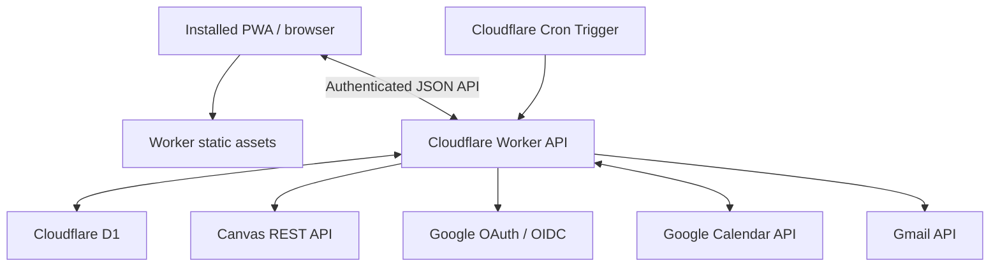

# Organato architecture and free stack

## 1. Architecture summary



The browser is presentation and interaction. The Worker is the only component that holds credentials or calls Canvas and Google with long-lived authorization. D1 stores the relational state. Cron keeps working while the PWA is closed.

## 2. Recommended stack

| Layer              | Choice                                                 | Reason                                                                  |
| ------------------ | ------------------------------------------------------ | ----------------------------------------------------------------------- |
| Language           | TypeScript                                             | One typed language across frontend, API, and jobs                       |
| Frontend           | React + Vite                                           | Mature open-source PWA ecosystem without a server-rendering requirement |
| Routing            | React Router                                           | Open-source client routing                                              |
| Styling            | CSS variables + CSS Modules or plain CSS               | Maximum visual control and low dependency weight                        |
| Data fetching      | TanStack Query                                         | Cache, mutations, retries, and server-state handling                    |
| Tables             | TanStack Table                                         | Headless open-source control for Notion-like grids                      |
| Calendar UI        | FullCalendar open-source core modules or a custom grid | Mature month/week/list behaviour; avoid premium modules                 |
| Dates              | date-fns + date-fns-tz or Temporal polyfill            | Explicit Sydney timezone handling                                       |
| Icons              | Lucide                                                 | Consistent open-source icons                                            |
| Validation         | Zod                                                    | Shared runtime schema validation                                        |
| API framework      | Hono on Cloudflare Workers                             | Small typed edge API                                                    |
| Database           | Cloudflare D1                                          | Serverless SQLite with a free plan                                      |
| Query layer        | Drizzle ORM or typed SQL                               | Migrations and typed schema without a hosted paid service               |
| Authentication     | Google OIDC + signed server session                    | Google-only, allow-listed access                                        |
| Scheduler          | Cloudflare Cron Triggers                               | Runs when the PWA is closed                                             |
| Testing            | Vitest + Testing Library + Playwright                  | Open-source unit, component, and browser tests                          |
| Formatting/linting | Prettier + ESLint                                      | Open-source quality gates                                               |
| Package manager    | pnpm                                                   | Fast, deterministic, open source                                        |

Every dependency must pass a licence check before adoption. Permissive licences such as MIT, Apache-2.0, BSD, or ISC are preferred. No premium FullCalendar plugins or commercial component packages may be used.

## 3. Why not use a browser-only app?

A browser-only PWA cannot reliably wake every hour while closed. It also cannot safely keep Canvas and Google refresh tokens in client storage. Server-side scheduling and secret handling are required for:

- Hourly Canvas checks.
- 6:00 AM email.
- Calendar reconciliation.
- Cross-device consistency.

The Worker supplies those capabilities without introducing a traditional always-on server.

## 4. Free-tier evidence

As of 25 July 2026:

- Cloudflare documents 100,000 Worker requests per day on the Free plan, five Cron Triggers, and D1 free-plan allowances of 5 million rows read/day, 100,000 rows written/day, and 5 GB storage.
- Cloudflare documents that static asset requests are free and unlimited.
- Google Calendar documents a standard threshold of 1,000,000 requests/day before future billing considerations.
- Gmail documents standard API use at no additional cost within its threshold; sending a message consumes 100 quota units.
- Canvas personal API access is supplied by the school installation rather than a paid application service.

Official references:

- [Cloudflare Workers limits](https://developers.cloudflare.com/workers/platform/limits/)
- [Cloudflare Workers and D1 pricing](https://developers.cloudflare.com/workers/platform/pricing/)
- [Google Calendar API limits](https://developers.google.com/workspace/calendar/api/guides/quota)
- [Gmail API limits](https://developers.google.com/workspace/gmail/api/reference/quota)
- [Canvas API documentation](https://developerdocs.instructure.com/)

Expected Organato usage is tiny: roughly 24 scheduled Canvas checks/day, one conditional daily email, a small number of calendar changes, and one person's UI traffic.

The production URL can use the free Cloudflare-provided `workers.dev` subdomain. A purchased custom domain is not required.

## 5. Free-only enforcement

No online provider can be guaranteed to keep the same terms forever. Organato turns the constraint into operational rules:

1. Do not attach a billing account or payment card to the Organato Google Cloud project.
2. Keep Cloudflare on Workers Free; do not enable the paid usage plan.
3. Treat quota exhaustion as a temporary service failure, never as permission to upgrade.
4. Implement internal daily ceilings far below provider thresholds.
5. Show usage estimates in Settings.
6. Review provider terms before every production deployment and at least every six months.
7. Pin dependencies and audit licences in CI.
8. Maintain JSON/CSV export and provider-independent domain models.
9. Never introduce a free trial as a required component.
10. If account creation for a proposed provider requires a card, reject that provider and use a fallback.

Suggested internal ceilings:

| Resource                | Organato ceiling  |
| ----------------------- | ----------------- |
| Canvas scheduled syncs  | 30/day            |
| Manual syncs            | 20/day            |
| Gmail messages          | 10/day            |
| Calendar API calls      | 5,000/day         |
| Worker dynamic requests | 10,000/day        |
| D1 writes               | 10,000/day        |
| Stored data             | Warning at 500 MB |

These are safety rails, not anticipated operating levels.

## 6. Fallback architecture

If Cloudflare's free account becomes card-gated or unsuitable, preserve the same TypeScript domain layer and run:

- The built frontend locally.
- The API/scheduler as a local Node process.
- SQLite as a local database.
- macOS `launchd` for hourly and morning schedules.

This fallback remains free and open source but loses reliable anywhere access unless the owner's Mac is on and safely reachable. It is a contingency, not the preferred production experience.

## 7. Repository structure

Recommended monorepo:

```text
organato/
├── apps/
│   ├── web/                 # React PWA
│   └── worker/              # API and scheduled handlers
├── packages/
│   ├── domain/              # Entities, rules, date/status calculations
│   ├── integrations/        # Canvas and Google adapters
│   ├── email/               # Versioned digest templates
│   ├── ui/                  # Reusable interface components
│   └── config/              # Shared lint, TypeScript, test configuration
├── migrations/              # D1 SQL migrations
├── docs/
├── scripts/
├── .github/workflows/       # Free CI where available
├── package.json
├── pnpm-workspace.yaml
└── wrangler.jsonc
```

Keep domain rules independent from Cloudflare bindings so they can run under the local fallback.

## 8. API boundaries

Suggested routes:

```text
GET    /api/session
POST   /api/auth/google/start
GET    /api/auth/google/callback
POST   /api/auth/logout

GET    /api/home
GET    /api/items
POST   /api/items
GET    /api/items/:id
PATCH  /api/items/:id
POST   /api/items/:id/classify
POST   /api/items/:id/archive
POST   /api/items/:id/restore
POST   /api/items/:id/reset-override

GET    /api/subjects
PATCH  /api/subjects/:id

GET    /api/calendar
GET    /api/statistics
GET    /api/history

GET    /api/settings
PATCH  /api/settings
GET    /api/integrations
POST   /api/integrations/canvas/connect
POST   /api/integrations/canvas/sync
POST   /api/integrations/google/connect
POST   /api/integrations/google/reconcile
POST   /api/integrations/email/test

GET    /api/export
POST   /api/import/preview
POST   /api/import/commit
```

Mutations require:

- Authenticated allow-listed session.
- CSRF protection.
- Runtime validation.
- Item version for optimistic concurrency.
- Structured audit entry.
- Idempotency key where externally observable.

## 9. Frontend state

- Server data belongs in the query cache.
- Unsaved form state remains local to its component.
- URL query parameters represent shareable filters and selected views.
- Theme and compactness may persist locally and in workspace settings.
- Secrets, access tokens, and refresh tokens never enter frontend state.
- Optimistic updates must roll back visibly when rejected.

## 10. PWA behaviour

Manifest:

- Name: Organato.
- Standalone display.
- Dark theme and background.
- Maskable open-source app icons created for the project.
- Shortcuts for Home, Todo, and New Todo.

Service worker:

- Cache hashed application assets.
- Use network-first behaviour for navigations.
- Do not cache authenticated API responses as an offline database.
- Clear old caches on activation.
- Show an update-ready banner instead of replacing the app while the owner is editing.

## 11. Database and migrations

- SQL migrations are committed and immutable after release.
- Development and production use separate D1 databases.
- Every migration has a tested rollback strategy even if D1 deployment uses forward fixes.
- Back up/export production data before destructive schema changes.
- Add indexes for active due-date queries, external Canvas identity, archive queries, calendar pending state, and reminder delivery keys.
- Query only required columns and use indexed filters to remain far below row-read limits.

## 12. Scheduled Worker constraints

Cloudflare documents a 15-minute Cron wall-time limit, but the Workers Free plan currently has a much tighter 10 ms CPU-time limit per invocation. Waiting for `fetch` and database I/O does not count as CPU, but JavaScript parsing and transformation do. An hourly Cron Trigger is the preferred candidate, not an unverified guarantee; Phase 0 must benchmark it with the owner's real course and assignment volume.

To stay within the Free plan:

- Bound course-fetch concurrency.
- Follow at most a configured number of pagination pages and report truncation.
- Avoid expensive HTML processing.
- Hash normalized records efficiently.
- Break calendar writes into bounded groups.
- Defer optional cleanup if core sync approaches its time budget.
- Store checkpoints so a partial run can be safely repeated.

If real usage cannot consistently fit the free CPU ceiling, do not upgrade. Move only scheduled orchestration to the documented free local Node/`launchd` fallback while keeping the hosted PWA and D1 API, or select another no-card, non-trial free scheduler after a fresh architecture review.

## 13. Observability without paid services

Use:

- Structured Worker logs.
- `sync_run` records in D1.
- A private integration-health page.
- A compact security-event log.
- Optional test email.

Do not require Sentry, Datadog, Logtail, or another paid/limited trial product.

Log levels:

- Info: run started/completed and counts.
- Warn: partial course failure, retry, stale integration.
- Error: authorization failure, invariant failure, delivery failure.

Logs must never contain tokens, authorization headers, full email MIME bodies, or unnecessary assignment content.

## 14. CI and quality gates

Every pull request should run:

- Formatting check.
- Lint.
- Type check.
- Unit tests.
- Component accessibility tests.
- Database migration test.
- Integration contract tests with recorded/redacted fixtures.
- Production build.
- Open-source licence allow-list check.
- Secret scan.

Browser tests can run on the default branch or before releases if free CI minutes are constrained.

## 15. Environments

### Local

- Local Worker emulator.
- Local D1.
- Fake Canvas and Google adapters by default.
- Optional real sandbox credentials in ignored local secret files.

### Preview

- Separate Worker and D1.
- Explicitly allow-listed preview URL.
- Google redirect URI registered separately.
- No production Canvas token.

### Production

- Production Worker and D1.
- Strict allowed origins.
- Cloudflare Free plan only.
- Google project without billing.
- Encrypted production credentials.

## 16. Performance targets

- Initial authenticated shell usable within 2 seconds on a typical school connection after first load.
- Page navigation under 150 ms once data is cached.
- Inline edit acknowledgement under 500 ms under normal conditions.
- Home API returns a purpose-built aggregate rather than many client round trips.
- Table remains responsive with at least 2,000 archived plus active items.
- Search debounced and indexed.
- No route should fetch the complete archive by default.
