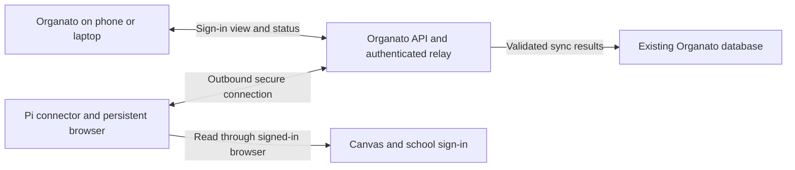

# Canvas connection proposal

Status: design only, awaiting approval. Prepared 5 September 2026.

## Recommendation

Use the Raspberry Pi 5 as a dedicated Canvas browser connector if school-approved Canvas OAuth is unavailable. Run Linux directly on the Pi; a VM adds no benefit here. Keep Organato's existing web app, Worker API, and D1 database online. The connector reads Canvas and sends assignment data to Organato. Canvas cookies remain on the connector.

The outcome is no manual cookie copying and background sync while the user's laptop is off. It is not a promise of permanent login. Canvas and the school's identity provider can expire or revoke sessions regardless of where cookies are stored. Establish the actual session lifetime during a trial before claiming reduced login frequency.

## Verified starting point

The public bundle served by https://organato.vercel.app on 5 September contains a “Reshet session cookie” field and submits `{ cookie: ... }` to `/api/integrations/canvas/connect`. No credentials were accessed.

This local checkout instead uses API tokens in `packages/integrations/src/canvas.ts`, `apps/worker/src/canvas-connection.ts`, and `apps/web/src/components/settings/CanvasConnectionSection.tsx`. Its configuration uses Vercel, Cloudflare Workers, D1, and a local scheduler. Before implementation, locate the source revision behind the deployed cookie integration and reconcile it with the existing uncommitted work. Do not overwrite that work or assume this checkout describes the production backend.

No authenticated production requests or session-expiry measurements were performed. The specific cause could include server expiry, rotation of cookies that the copied value cannot follow, or application persistence errors. A VM alone resolves none of those distinctions.

## First choice when school support is available

Canvas OAuth lets the user press Connect Canvas in Organato, authenticate on the genuine school/Canvas site, approve access, and return to Organato. The backend exchanges the authorization code and stores encrypted access and refresh tokens scoped to the workspace. Refresh happens server-side before sync, with a lock around concurrent refreshes and atomic credential replacement. A revoked refresh token becomes a reconnect prompt.

Use a fixed callback URL, short-lived single-use state bound to the signed-in Organato account, and only the identity, course, assignment, and submission read scopes actually needed. Verify the returned Canvas identity before binding it. This path needs a developer key enabled by the school's Canvas administration. It needs no browser connector or VM. Ordinary Canvas cookies cannot be converted into OAuth refresh tokens. See [Canvas developer keys](https://developerdocs.instructure.com/services/canvas/oauth2/file.developer_keys) and [OAuth endpoints](https://developerdocs.instructure.com/services/canvas/oauth2/file.oauth_endpoints).

## Browser connector design

The Pi runs a maintained 64-bit Linux installation, Node.js connector, Chromium controlled by Playwright, a virtual display, and a VNC server bound only to localhost. Organato uses noVNC to display that browser during sign-in. The connector runs under systemd with automatic restart, a dedicated OS user, and a persistent browser profile on disk. Target one user initially, provision approximately 2–4 GB of available RAM, and measure actual usage on the Pi. Keep the browser running between syncs initially; verify restart behavior because not all session state necessarily survives browser exit.

Playwright supports a persistent browser data directory. noVNC provides browser-based remote viewing and input. These building blocks do not establish that Emanuel's sign-in permits a remote Linux browser. See [Playwright persistent contexts](https://playwright.dev/docs/api/class-browsertype#browser-type-launch-persistent-context) and [noVNC](https://novnc.com/info.html).

The Pi initiates an outbound TLS WebSocket to a Cloudflare Durable Object relay. The user connects to that relay only during sign-in. No router port forwarding, public VNC, or public browser-debugging port is needed. Use a SQLite-backed Durable Object with WebSocket hibernation, available on the Workers Free plan subject to quotas. Keep sign-in streams time-limited and measure their use before calling the deployment free. See [Cloudflare WebSockets](https://developers.cloudflare.com/durable-objects/best-practices/websockets/) and [pricing](https://developers.cloudflare.com/durable-objects/platform/pricing/).

The existing Vercel frontend should connect directly to the authenticated Worker WebSocket endpoint with an explicitly permitted CSP destination, rather than assuming the existing HTTP rewrite transports WebSockets. The Worker issues a short-lived single-use connection ticket after normal Organato authentication and CSRF checks. Validate the WebSocket Origin and bind both ends to the same workspace and connector. Never place a reusable credential in a URL.

## User sign-in

1. The operator installs the connector once and pairs its device identity through a short-lived code in Organato Settings. Pairing binds the device to one workspace.
2. The user selects Settings → Canvas → Connect Canvas. Organato requires recent account authentication and opens a dedicated sign-in panel.
3. The panel clearly says the browser runs on the user's connector and displays its destination domain. It streams the actual remote browser, including genuine Canvas/school pages. It is not a copied password form or a direct Canvas iframe.
4. The user completes school sign-in and MFA. Input travels through the authenticated relay to the browser. Organato infrastructure therefore handles the stream, but must never log keystrokes, record the session, retain screenshots, or enable browser password saving.
5. The connector verifies the Canvas user and proves it can read courses and assignments. Organato shows the detected account for confirmation before binding and importing, preventing accidental account mix-ups.
6. The remote-control connection closes immediately after confirmation. The browser session stays on the Pi. The UI shows Connected, last successful sync, next sync, and connector health.
7. If authentication expires, the user selects Reconnect and completes the same flow. The existing school session may shorten it, but MFA remains user-driven.

Limit each interactive session to ten minutes, allow one controller, disable clipboard/file transfers and downloads, and restrict the isolated browser to Canvas and verified school identity-provider destinations. Block local/private-network access. Do not expose the Pi desktop or shell. Remote login may fail with device compliance, hardware-bound passkeys, or identity-provider restrictions. If it does, stop this approach and reassess OAuth or a separately approved local companion. Do not work around school authentication controls.

## Synchronization and storage

The connector checks a due-job endpoint once per minute, performs an hourly sync, and accepts Sync now through the same job path. Reads run inside the signed-in browser against verified Canvas endpoints so browser-managed cookie updates remain with the session. Do not copy a cookie into the old token provider. Do not poll Canvas solely to evade session expiry.

Use server-issued job IDs, expiring leases, reconnect backoff, and bounded retry. Run one login or sync operation per profile at a time. Persist pending result delivery until acknowledged; reject obsolete connection generations after replacement or disconnect. Bind the Canvas user ID and server-assigned workspace to every import. Never trust a workspace ID supplied in the payload alone.

Upload normalized courses, assignments, submission state, pagination completeness, and per-course success/failure. Reuse the existing reconciliation rules after extracting their data-input boundary. Preserve user edits and archive only after the existing successful-complete-sync criteria are met. Failed or partial reads must not imply assignments disappeared. Initial scope is the data Organato already imports; extra Canvas features need explicit data contracts.

Cookies and browser storage stay in a restricted profile on the Pi. They are credentials and may include a broader school SSO session. Keep profiles out of repositories, ordinary backups, logs, and telemetry. Use encrypted storage where operationally practical; unattended reboot requires a considered key-unlock arrangement and cannot provide perfect protection against a stolen running device. Organato stores connector identity, credential hashes, account binding, health, and imported data. The connector holds no general database or administrator key.

For more users, require separate OS/container isolation, profiles, display processes, credentials, and access tickets per workspace. Do not offer shared hosting for students until isolation and capacity are verified.

## What stays running

| Component | Requirement |
| --- | --- |
| Organato frontend, API, D1, relay | Remain hosted online |
| Pi, connector, browser | Powered and connected for background sync |
| User's laptop or phone | Only needed to use Organato or complete sign-in |
| Scheduling | Connector drives its Canvas jobs; retain exactly one scheduler for existing email/calendar jobs |

Audit the current local scheduler before cutover. Replace its Canvas dispatch for connector accounts without duplicating or disabling unrelated reminders. Migrating all reminders off the Mac is a separate scheduling decision, though the Pi can host the existing timer after verification.

If the Pi is offline, retain assignments and display Sync delayed with the last-success timestamp. On recovery, perform one catch-up sync. If Canvas requires login, pause Canvas retries and show Reconnect. For rate limits or outages, retry with backoff. Disconnect immediately revokes server access and queues profile erasure. If the Pi is offline, explicitly show local erasure pending until it acknowledges deletion. Users may also need to revoke the school session through the provider.

## Hosting choice

| Option | Assessment |
| --- | --- |
| Raspberry Pi 5 | Recommended for this personal setup. Existing hardware, local custody of school sessions, no VM rental. Needs power, internet, updates, and disk health management. Electricity is not free. |
| Oracle Always Free ARM VM | Best cloud candidate to trial. Current documentation lists an allowance equivalent to 2 OCPUs and 12 GB RAM. Capacity can be unavailable and idle instances may be reclaimed. Use the same connector package, confirm free eligibility, and avoid paid resources. |
| Google Cloud free e2-micro | Free compute/storage allowances exist, but it is a less comfortable browser host. Confirm region, network, and other chargeable resources before use. |

The Oracle option is conditional rather than a promise of a reliable free always-on VM. Official references: [Oracle Always Free](https://docs.oracle.com/en-us/iaas/Content/FreeTier/freetier_topic-Always_Free_Resources.htm), [Google free tier](https://docs.cloud.google.com/free/docs/free-cloud-features). Plan for reauthentication when moving a connector between machines, rather than copying live school sessions across providers.

## Implementation after approval

1. Reconcile the deployed cookie source with this checkout and diagnose the current failure without logging secret values.
2. Prove real Emanuel login, assignment reads, session persistence, and mobile remote input on the chosen host. Observe at least 48–72 hours and preferably beyond the user's current failure interval. Report forced reauthentication honestly.
3. Build pairing, relay authorization, isolated browser management, Connect/Reconnect UI, and job ingestion. Keep the old connection available until the new one has passed validation.
4. Verify wrong-account isolation, ticket replay rejection, disconnect during sync, offline recovery, process and machine restart, cookie expiry, partial pagination, duplicate delivery, and preservation of overrides. Check the actual database results and absence of credential logs.
5. Run relevant tests, type checks, lint, build, and live UI checks. Prepare deployment and rollback instructions. Obtain approval before changing production.

Approval requested: the Pi connector design and feasibility trial, with Oracle as an optional hosting alternative. Implementation has not started. If school-enabled OAuth is available, prefer that smaller architecture instead.
