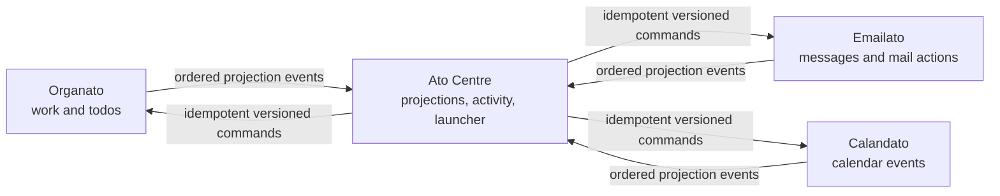

# Ato cross-app integration framework

**Status:** proposed v1 contract and adoption standard  
**Audited:** 31 July 2026  
**Apps:** Organato, Emailato, Calandato, Ato Centre  
**Companion implementation:** [`integration/`](integration/README.md)

This document defines how every Ato app exchanges data with Ato Centre without
coupling databases, leaking credentials, or letting an outage in one app damage
another. It is the normative architecture for new work. The JSON Schemas and
OpenAPI file in `integration/` are the machine-readable contract.

## 1. Decisions at a glance

1. **Each app owns its domain and database.** Ato Centre is an index, activity
   view, launcher, and command coordinator—not the master database for email,
   calendars, or work items.
2. **No app reads or writes another app's tables.** All cross-app traffic uses
   the versioned `/ato/v1` service contract.
3. **The durable source is an app-local transactional outbox.** Centre pulls
   ordered events using a cursor. An optional webhook may wake Centre sooner,
   but never carries private record data and is never the only delivery path.
4. **Centre stores minimal projections.** It keeps only fields needed to show,
   search, sort, count, deep-link, and offer safe actions. Detailed content is
   fetched from or opened in the owner app.
5. **Commands go back to the owner app.** They include an idempotency key and
   expected resource version. The owner app validates and commits the change,
   then emits the resulting event.
6. **Sync is at-least-once and idempotent.** Duplicates are normal; data loss and
   double mutation are not.
7. **Server-to-server requests are HMAC signed over TLS.** User browser sessions,
   Google tokens, Canvas tokens, and provider credentials are never shared.
8. **UTC instants and explicit local dates remain distinct.** The suite default
   is `Australia/Sydney`; an all-day date is never silently converted to UTC.
9. **Offline changes stay in the owner app.** Centre may show cached data as
   stale, but must not claim that a remote action succeeded until the owner app
   acknowledges it.

## 2. Repository audit and implementation reality

The design below distinguishes observed code from greenfield assumptions.

| App        | Current repository state                                                                        | Observed stack/data model                                                                                                                                                          | Integration consequence                                                                                                                                                                        |
| ---------- | ----------------------------------------------------------------------------------------------- | ---------------------------------------------------------------------------------------------------------------------------------------------------------------------------------- | ---------------------------------------------------------------------------------------------------------------------------------------------------------------------------------------------- |
| Organato   | Implemented and deployed project                                                                | pnpm monorepo; Node 22; TypeScript; React/Vite PWA; Hono Cloudflare Worker; Cloudflare D1/SQLite; Zod; Google OIDC; cookie session + CSRF; Canvas, Google Calendar, Gmail adapters | Build the first real adapter here. Reuse D1, UUID IDs, `item.version`, runtime validation, audit history, and Worker API patterns.                                                             |
| Emailato   | Git repository with no commits and no checked-out source                                        | No stack or data model exists yet                                                                                                                                                  | Adopt this contract at project creation. Do not assume Gmail, Outlook, local-first storage, or a particular framework until its own product decision is made.                                  |
| Calandato  | Git repository with no commits and no checked-out source                                        | No stack or data model exists yet                                                                                                                                                  | Adopt canonical IDs, explicit date/time semantics, and outbox tables from the first migration.                                                                                                 |
| Ato Centre | Folder is currently named `ato centre`; Git repository has no commits and no checked-out source | No stack or database exists yet                                                                                                                                                    | Recommended implementation is TypeScript plus SQLite/D1 to align with Organato, but the wire contract is language-neutral. Centre begins as a read model and launcher before gaining commands. |

The requested workspace label “Command Centre” did not exist at audit time; the
available repository was `ato centre`. Renaming it is a separate repository
decision. Integration uses the stable app slug `ato-centre` regardless of the
folder or display name.

### Organato facts this contract preserves

- `item.id` and related entity IDs are UUID strings.
- `item.version` is a positive optimistic-concurrency counter.
- Items distinguish `kind` (`work`/`todo`), classification, source type,
  persisted working status, derived overdue state, priority, archive state,
  notes, recurrence, reminders, and Calendar sync state.
- Deadlines distinguish a UTC `dueAt` from a Sydney `dueDateLocal`, with
  `dueHasExplicitTime` preventing ambiguous conversion.
- Canvas identity is unique by hashed installation + assignment ID; manual
  overrides survive later Canvas refreshes.
- Current item mutations require the submitted version and return `409` on a
  conflict. Authenticated browser mutations use same-origin cookies, Origin
  validation, and `X-CSRF-Token`.
- D1 already has history, security events, sync-run records, provider health,
  idempotent reminder-delivery keys, and encrypted provider credentials.
- Organato intentionally does not keep authenticated API data as an offline
  database. The new cross-app layer must not weaken that boundary.

Organato does **not** yet expose `/ato/v1`, emit an Ato outbox event, or accept an
Ato service credential. These are adoption tasks, not hidden current features.

## 3. System boundaries and ownership



| Domain                                | Authoritative app | Centre may retain                                                                                                 | Centre must not retain by default                                                        |
| ------------------------------------- | ----------------- | ----------------------------------------------------------------------------------------------------------------- | ---------------------------------------------------------------------------------------- |
| Work, assignments, checkpoints, todos | Organato          | Name, classification/status, deadline, priority, subject label/ID, archive flag, deep link, capabilities          | Notes, attachment URLs, Canvas payloads, history diffs, provider IDs/tokens              |
| Email/messages                        | Emailato          | Truncated subject, sender display label, received time, unread/flag state, mailbox label, deep link, capabilities | Body, attachments, full headers, raw addresses unless required and explicitly classified |
| Calendar                              | Calandato         | Event title, start/end or all-day dates, calendar label, response/state, deep link, capabilities                  | Description, meeting links, attendee addresses, private notes unless expressly enabled   |
| Cross-app feed, pins, dismissals      | Ato Centre        | Its own UI state and resource references                                                                          | Copies of complete source records                                                        |

Provider connections remain with their domain owner. Emailato owns mail-provider
tokens; Calandato owns calendar-provider tokens. During transition, Organato may
continue owning its existing Google Calendar/Gmail connections. Moving those
responsibilities later requires an explicit migration; two apps must never both
write the same provider object without a declared single writer.

## 4. Canonical identity

Every exported resource has a global ID:

```text
ato:<owner-app>:<resource-type>:<local-id>
```

Examples:

```text
ato:organato:item:6a14d912-42bb-4fc3-b4e2-98f55ef8f901
ato:emailato:message:01J4ZP7VY76KQ67QG4ABCD1234
ato:calandato:event:4c6bb3ab-c84c-4f05-a60f-f9ba7e3f86ff
```

Rules:

- App and resource-type slugs are lowercase, stable, and never repurposed.
- Local IDs are opaque URL-safe tokens; consumers never infer timestamp or type
  from them.
- Renaming a product or moving folders does not change IDs.
- A provider ID is an `externalRef`, not a canonical ID. Never use a Gmail
  message ID, Google event ID, or Canvas ID alone because provider scopes can
  collide.
- A resource's owner never changes. A cross-app relationship stores canonical
  IDs for both sides rather than transferring identity.
- IDs are non-secret and may appear in logs. They still count as metadata and
  must not be exposed through public unauthenticated endpoints.

Use `canonicalId()` and `parseCanonicalId()` from the reference kit. Existing
Organato UUIDs fit without a database rewrite.

## 5. Centre projection contract

Centre ingests a small `projection` rather than each app's internal model. The
normative schema is `integration/contracts/v1/projection.schema.json`.

Core fields:

| Field                        | Meaning                                                     |
| ---------------------------- | ----------------------------------------------------------- |
| `id`                         | Canonical ID                                                |
| `ownerApp`, `resourceType`   | Routing and filtering                                       |
| `version`                    | Owner app's monotonic resource version                      |
| `title`, `subtitle`, `state` | Minimal display content                                     |
| `occurredAt`                 | Feed timestamp, such as received mail time                  |
| `dueAt`                      | UTC instant when the concept has an exact time              |
| `dateLocal`                  | `YYYY-MM-DD` for date-only concepts                         |
| `updatedAt`                  | Owner-app update time                                       |
| `deepLink`                   | App-relative path resolved against configured app base URL  |
| `badges`                     | Small, non-authoritative display tags                       |
| `dataClassification`         | `metadata`, `personal`, or `sensitive`                      |
| `capabilities`               | Actions Centre may currently offer                          |
| `appData`                    | Small app-owned extension; not a place to copy full records |

### Current domain mappings

**Organato `item` → projection**

- `id`: `ato:organato:item:${item.id}`
- `version`: current `item.version`
- `title`: `displayName`
- `subtitle`: resolved subject display name, if any
- `state`: archived, completed, submitted, overdue, in progress, or not started
  using Organato's existing derived-status rule
- `dueAt`: `dueAt`; `dateLocal`: `dueDateLocal` (never set both)
- `badges`: classification and priority, omitting null values
- `capabilities`: `open`; add `complete` or `archive` only when valid; add
  `restore` only for archived items
- `appData`: only `kind`, `classification`, and canonical/opaque subject ID
- exclude notes, attachments, Canvas URL and IDs, source hashes, overrides,
  recurrence details, and history

**Emailato `message` → projection (initial proposal)**

- title is a sanitized/truncated subject; subtitle is a display label rather
  than a raw address when possible
- state is `unread`, `read`, or `archived`; badges may include `flagged`
- `occurredAt` is provider-received time
- body preview is opt-in sensitive data and excluded in v1
- capabilities begin with `open`, `mark-read`, and `archive`

**Calandato `event` → projection (initial proposal)**

- exact event uses `dueAt` only if Centre presents it as a deadline; otherwise
  event-specific start/end stay in a small versioned `appData.schedule`
- all-day events use local dates and the event's IANA timezone
- state may be `confirmed`, `tentative`, or `cancelled`
- description, attendee list, conference URL, and private calendar IDs are
  excluded in v1

Emailato and Calandato mappings must be ratified against their real models once
those projects have source code. The shared core must remain unchanged; add an
app-specific extension schema when needed.

## 6. Event envelope and semantic rules

The normative envelope is
`integration/contracts/v1/event-envelope.schema.json`. Example:
`integration/examples/organato-item-updated.json`.

```json
{
  "specVersion": "1.0",
  "id": "123e4567-e89b-42d3-a456-426614174000",
  "source": "organato",
  "type": "organato.item.updated",
  "occurredAt": "2026-07-31T10:15:30.000Z",
  "sequence": 27,
  "subject": "ato:organato:item:6a14d912-42bb-4fc3-b4e2-98f55ef8f901",
  "resourceVersion": 4,
  "traceId": "8c760d70-3610-4783-aa5a-130829d8f0ce",
  "dataClassification": "personal",
  "data": { "...": "projection for an upsert" }
}
```

Rules:

- `id` uniquely identifies one immutable event. Retrying preserves it.
- `sequence` is a gap-free, monotonically increasing outbox position **within
  one source app**. Centre cursors are per app.
- `resourceVersion` increases on each meaningful owner-app mutation. Centre
  applies an event only when its resource version is greater than the stored
  version. Equal is a duplicate; lower is stale.
- Event types use `<app>.<resource>.<past-tense-action>`. V1 lifecycle actions
  are `created`, `updated`, `archived`, `restored`, and `deleted`.
- Created/updated/archived/restored data is a complete current projection, not a
  partial patch. This makes replay deterministic.
- Deleted data is a tombstone containing `id`, `version`, `deletedAt`, and no
  private content. Centre marks the projection deleted, then purges it according
  to retention policy.
- `occurredAt` is when the source committed, not when Centre received it.
- `traceId` follows the operation across services and logs.
- `correlationId` is the initiating command ID when an event resulted from a
  Centre command.

### Contract versioning

- `/ato/v1` is the major transport version. `specVersion: 1.0` is the envelope
  major/minor.
- Within major v1, producers may add optional fields and new event types.
  Consumers must ignore unknown optional fields and quarantine unknown event
  types without advancing past an invalid event until policy says to skip it.
- Removing/renaming a field, changing meaning, or changing an existing field's
  type requires `/ato/v2` and a parallel migration period.
- Each app publishes supported versions and capabilities at `/manifest`.
- Producers support the previous major for at least one deployed Centre release
  or until telemetry shows it unused. No producer switches major silently.
- JSON Schemas are immutable after release. Corrections create `1.1` or v2; Git
  history is not a substitute for a versioned contract.

## 7. Transport contract

Each app exposes the API in `integration/openapi/ato-v1.yaml`:

```text
GET  /ato/v1/manifest
GET  /ato/v1/health
GET  /ato/v1/events?cursor=<sequence>&limit=100
GET  /ato/v1/snapshot?cursor=<opaque>&limit=100
POST /ato/v1/commands
```

All responses use JSON UTF-8; request/response bodies are capped at 256 KiB.
Pages cap at 500 records. Timeouts are 10 seconds at Centre, with a maximum of
three attempts for safe reads. Command retries reuse the idempotency key.

### Normal sync sequence

1. Owner app commits its domain mutation, current projection, and outbox event
   in one database transaction/D1 batch.
2. Centre polls events strictly after its committed cursor.
3. Centre validates schema, source/subject agreement, and sequence order.
4. Centre transactionally inserts the event ID into its receipt log, upserts or
   tombstones the projection if the resource version is newer, and advances the
   source cursor.
5. Centre commits before fetching the next page. A crash before commit safely
   replays the page.
6. Source retains events for at least 30 days. If a cursor predates retention,
   it returns `410 cursor_expired`; Centre rebuilds that app from snapshot.

An optional webhook from the app to Centre contains only `source`,
`currentSequence`, and `traceId`. It schedules an immediate pull. If it is lost,
the regular poll heals the delay.

### Snapshot correctness

The source maintains its exported projection with `source_sequence`. The first
snapshot response establishes watermark `W`. Every page returns only the latest
projection rows whose source sequence is `<= W`, ordered by canonical ID. Rows
updated after `W` may be absent; their events have sequence `> W` and are pulled
after the snapshot. The opaque page cursor binds to the same watermark. Centre:

1. builds a staging projection for that source;
2. reads all pages for watermark `W`;
3. atomically replaces the source's live projection with staging;
4. sets its event cursor to `W`;
5. pulls events after `W`.

This prevents a mixed-time snapshot from overwriting a newer event.

## 8. Commands and conflict ownership

Centre never directly updates a source projection. It sends a command to the
owner app:

```json
{
  "id": "223e4567-e89b-42d3-a456-426614174000",
  "type": "organato.item.complete",
  "subject": "ato:organato:item:6a14d912-42bb-4fc3-b4e2-98f55ef8f901",
  "expectedVersion": 4,
  "traceId": "8c760d70-3610-4783-aa5a-130829d8f0ce",
  "requestedAt": "2026-07-31T10:16:00.000Z",
  "data": {}
}
```

The request also has an `Idempotency-Key`, derived from stable command intent.
The owner app stores the key, request hash, status, and response before returning.

| Situation                              | Required result                                                                                                             |
| -------------------------------------- | --------------------------------------------------------------------------------------------------------------------------- |
| Same key, same body, already succeeded | Return the stored successful response; do not mutate again                                                                  |
| Same key, different body               | `409 idempotency_mismatch`                                                                                                  |
| `expectedVersion` differs              | `409 version_conflict` with `currentVersion`; Centre refreshes and asks user to retry if intent is no longer trivially safe |
| Command invalid in current state       | `422 invalid_state`                                                                                                         |
| Unknown/hidden resource                | `404 resource_not_found` (do not reveal authorization details)                                                              |
| Accepted asynchronous work             | `202`; final owner event carries `correlationId = command.id`                                                               |

For Organato, v1 commands should initially be limited to capabilities already
represented by safe mutations: complete/reopen, archive, and restore. Route them
through the same domain functions and `item.version` checks as the current API;
do not call existing browser endpoints internally or bypass `item_history`.

### Conflict policy

- Owner-app version wins over Centre cache.
- Centre never uses timestamp-only last-write-wins for user data.
- A version conflict is visible, refreshable state—not a silent overwrite.
- A local source/provider conflict (for example Organato versus Google Calendar)
  stays governed by the owner app's current rules. Centre displays the resulting
  state but does not invent a third merge algorithm.
- Independent fields may later use field-level commands, but only after the
  owner app exposes a field version or merge rule. V1 commands are domain actions.

## 9. Outbox, inbox, retries, and idempotency

The portable migration is `integration/sql/sqlite/001_ato_integration.sql`.

### Producer transaction

For every Centre-visible mutation:

```text
BEGIN / D1 batch
  mutate authoritative record with expected version
  append normal app history/audit entry
  allocate next ato_outbox.sequence
  upsert exported ato_projection with that sequence
  insert immutable event envelope using the same projection
COMMIT
```

Never publish before the domain commit. Never construct the event later from a
potentially newer row. If one atomic D1 batch cannot both allocate sequence and
embed it, use a dedicated per-app sequence row or insert the outbox skeleton and
finalize it within the same transaction; test concurrent writers.

### Consumer transaction

Centre keeps one cursor per source app and event IDs for deduplication. In a
single transaction it:

- verifies expected next sequence;
- ignores exact duplicate event IDs;
- rejects an event ID reused with different content as a security/invariant
  failure;
- applies only a higher resource version;
- records the receipt and advances the cursor.

### Retry schedule

Use exponential backoff with full/half jitter: approximately 1s, 2s, 4s, 8s,
then cap at 15 minutes. Respect `Retry-After`. Reset failure count after a
successful page. Do not retry validation, authorization, or unsupported-version
errors automatically. Surface them as action-required.

Commands retain receipts for at least 30 days; externally observable or
destructive commands should retain the receipt as long as their audit entry.
Nonce replay records need only 10 minutes plus clock-skew margin.

## 10. Service authentication and authorization

Browser authentication is separate from service authentication. Organato's
Google OIDC cookie + CSRF model remains correct for its browser; Centre must not
copy that cookie or call an API while impersonating the user.

Every service request uses HTTPS and these headers:

```text
Authorization: Ato-HMAC keyId="centre-2026-01",signature="<base64url>"
X-Ato-Timestamp: 2026-07-31T10:16:00.000Z
X-Ato-Nonce: 323e4567-e89b-42d3-a456-426614174000
X-Ato-Content-SHA256: <base64url SHA-256 of raw body bytes>
```

Canonical string:

```text
<UPPERCASE METHOD>\n
<path and canonical sorted query>\n
<content SHA-256>\n
<X-Ato-Timestamp>\n
<X-Ato-Nonce>
```

`signature = base64url(HMAC-SHA-256(secret, canonicalString))`.

Verifier requirements:

- select the secret by `keyId`; compare MACs in constant time;
- reject timestamps more than five minutes from server time;
- insert `(keyId, nonce)` before execution and reject reuse;
- verify the raw body hash before parsing;
- authorize key capabilities (`events:read`, `snapshot:read`,
  `commands:write`) and allowed resource/command types;
- rate-limit by key and endpoint;
- return a generic `401`/`403` without leaking which check failed.

Generate 256-bit random secrets, store only encrypted secret material or a
platform secret binding, never `.env` committed content. Rotate by installing a
new key on both sides, switching the caller, observing usage, then revoking the
old key. Support two active keys during rotation. Separate development and
production credentials and databases.

If the suite later adopts asymmetric Ed25519 signatures, introduce it as a
manifest-advertised auth capability; do not reinterpret `Ato-HMAC`.

## 11. Deep links and navigation

Projections carry an app-relative link such as:

```text
/work?item=6a14d912-42bb-4fc3-b4e2-98f55ef8f901
```

Centre stores each app's trusted base URL in configuration and resolves relative
links itself. It rejects absolute, protocol-relative, `javascript:`, `data:`,
path-traversal, and unregistered-host links. The source app must:

- authenticate normally after navigation;
- preserve the intended destination through sign-in using a validated relative
  return path;
- show a clear not-found/archived message rather than a blank page;
- make the selected resource keyboard-focusable;
- avoid placing titles, email addresses, tokens, or private text in URLs.

Centre's own stable redirect form may be:

```text
/open/ato:organato:item:6a14d912-42bb-4fc3-b4e2-98f55ef8f901
```

It resolves the canonical ID to the configured owner app and current deep link.
A future native `ato://` scheme may wrap this redirect, but is not required for
the web/PWA v1.

## 12. Errors and operability

APIs return `application/problem+json` with stable machine code, safe title,
HTTP status, trace ID, and optional retry/current-version fields. Required v1
codes:

| HTTP | Code                                                       | Retry?                   |
| ---- | ---------------------------------------------------------- | ------------------------ |
| 400  | `invalid_request`                                          | No                       |
| 401  | `invalid_signature`                                        | No; check clock/key      |
| 403  | `insufficient_scope`                                       | No                       |
| 404  | `resource_not_found`                                       | No                       |
| 409  | `version_conflict`, `idempotency_mismatch`, `sequence_gap` | Refresh/reconcile        |
| 410  | `cursor_expired`                                           | Rebuild snapshot         |
| 413  | `payload_too_large`                                        | No; reduce projection    |
| 422  | `invalid_state`, `unsupported_command`                     | No                       |
| 429  | `rate_limited`                                             | Yes, honor `Retry-After` |
| 500  | `internal_error`                                           | Yes, bounded             |
| 503  | `temporarily_unavailable`                                  | Yes, bounded             |

No error or log contains access tokens, signatures, nonces beyond a short hash,
raw email bodies, notes, attachments, provider payloads, or full request bodies.

### Structured observability

Every app emits safe structured records with:

```text
timestamp, level, app, operation, traceId, eventId/commandId,
subjectHash, sequence, result, durationMs, retryCount, errorCode
```

Centre exposes a private integration-health view per source:

- last attempt and last successful pull;
- current source sequence and committed Centre cursor (lag);
- oldest retained sequence;
- consecutive failures and safe error code;
- last snapshot time and whether rebuild is required;
- quarantined event count;
- command success/failure and p50/p95 latency.

Suggested alerts in the UI: warning after 15 minutes or three failed pulls;
action required after one hour, cursor expiry, auth failure, sequence gap, or
schema failure. Since these are personal apps, D1 tables and structured Worker
logs are sufficient; no paid observability dependency is required.

## 13. Offline and degraded behavior

- A source app may continue its own supported offline behavior and enqueue an
  outbox event when its authoritative mutation reaches the server.
- Ato Centre shows the projection's `updatedAt` and a stale/offline indicator if
  source health is delayed. It may still open cached read-only details that its
  privacy policy permits.
- Centre queues at most safe, explicitly user-requested commands. A queued card
  says “Waiting to sync,” not “Completed.” The same idempotency key is retained
  across retries.
- Destructive commands and actions requiring fresh state are disabled offline.
- When connectivity returns, Centre refreshes events before dispatching a queued
  command. A version mismatch returns the item to user review.
- Organato currently treats offline mode as out of scope and uses only cached
  static assets; therefore its initial adapter should reject commands while its
  Worker is unreachable, not attempt browser-local domain writes.

## 14. Security and privacy baseline

1. Minimize projections; start with no email body, calendar description,
   attendees, Organato notes, attachments, or provider IDs.
2. Mark records `metadata`, `personal`, or `sensitive`. Centre may index metadata
   and personal fields; sensitive fields require a documented feature need,
   explicit setting, encrypted storage, redacted logs, and retention review.
3. Encrypt provider and service credentials at rest; use different keys and AAD
   namespaces. Never put credentials into outbox, snapshots, history, exports,
   URLs, client bundles, or events.
4. Keep service endpoints private-by-auth even though canonical IDs are opaque.
5. Validate JSON at ingress and before egress. Reject unknown top-level fields
   for commands; size-limit strings and arrays.
6. Apply least privilege by app/key/command. Centre does not gain raw provider
   API scopes merely because a spoke app has them.
7. Record security events for key install/revoke, repeated signature failure,
   replay attempts, unexpected sequence reuse, permission denial, export, and
   destructive commands.
8. Backups/exports declare whether Centre projections are included. Restoring a
   source app with older versions requires a new source epoch or a full Centre
   resnapshot; never emit lower versions into the same identity stream.
9. Delete propagates as a tombstone. Centre removes searchable/display content
   immediately and retains only minimal audit metadata for the declared period.
10. Review CORS separately. Service endpoints should not allow arbitrary browser
    origins; requests are server-to-server and signatures do not make broad CORS
    safe.

### Threats explicitly handled

- replayed commands: nonce window + durable idempotency receipts;
- duplicate/out-of-order delivery: event ID, sequence cursor, resource version;
- stolen browser session: cannot act as Centre service;
- stolen service key: scoped key, rate limits, rotation, audit, no provider token;
- malicious deep link: relative-only validation and configured base URL;
- poison event blocking sync: quarantine with visible action required, followed
  by a deliberate operator skip or producer repair—never silent loss;
- partial writes: domain/projection/outbox atomic transaction;
- accidental content aggregation: schema/data-minimization limits.

## 15. Database migration and release discipline

- Integration migrations are immutable, forward-only, and applied first to a
  development database. Export/backup before destructive production changes.
- Start with the companion SQLite/D1 migration. Each app may prefix or adapt
  names, but semantics and uniqueness constraints stay intact.
- Backfill existing records in deterministic ID order. For each page, produce a
  current projection and initial `created` event without changing the source
  record's version. Record a backfill checkpoint so interruption is resumable.
- Deploy read paths before emitting events. Safe order: tables → manifest/health
  → snapshot/events endpoints → Centre shadow consumer → producer writes →
  visible Centre UI → commands.
- During dual-read validation, compare counts and sampled projection hashes; do
  not dual-write the authoritative domain into Centre.
- A rollback stops emitting/consuming a new contract version but does not edit
  or reuse already published events. Repair forward or resnapshot.
- Restore tests must cover outbox/projection consistency, cursor expiry,
  duplicate events, sequence gaps, and service-key rotation.

## 16. Phased adoption plan

### Phase 0 — Ratify and test the contract

- Review privacy fields and approve stable app/resource slugs.
- Run the dependency-free tests and SQL syntax check in CI.
- Add schema-fixture tests in every repo.
- Decide Ato Centre's final repository/display name without changing slug.

Exit: all repos pin the same v1 artifacts and name an integration owner.

### Phase 1 — Centre read-only with Organato

- Add the SQL tables to Organato's D1 migration chain.
- Create an Organato projection mapper from existing `OrganatoItem` and Subject.
- Emit projection + outbox in the same D1 batch as create, patch, classify,
  archive, restore, recurrence creation, Canvas updates, and permanent deletion.
- Expose signed manifest, health, events, and snapshot routes in the Worker.
- Build Centre cursor consumer and private health page.
- Run shadow ingestion; compare active/archived counts and sampled records.

Exit: Centre can rebuild from snapshot, catch up by events, survive duplicate
pages and cursor expiry, and links open the right Organato record.

### Phase 2 — Greenfield integration in Emailato and Calandato

- Put UUID/ULID local IDs and positive resource versions in first schemas.
- Make outbox/projection writes part of their first domain transaction.
- Ratify app-specific extension schemas against actual privacy needs.
- Add snapshot/event contract tests before Centre displays either app.

Exit: all three source apps show bounded lag and successful rebuilds.

### Phase 3 — Safe commands

- Implement scoped HMAC keys, nonces, command receipts, and rotation runbook.
- Start with reversible actions: Organato complete/archive/restore, Emailato
  mark-read, and Calandato response/status changes only after domain rules exist.
- Add explicit pending, succeeded, conflict, and failed UI states in Centre.
- Chaos-test response loss after commit to prove no double mutation.

Exit: replay, mismatch, conflict, outage, and stale-cache tests pass.

### Phase 4 — Cross-app workflows

- Add relationships by canonical ID, not copied records: email → work item,
  calendar event → work item, or Centre pin → source resource.
- Any automated workflow declares trigger, owner, permissions, idempotency key,
  cancellation, and audit record.
- Keep provider single-writer ownership explicit before moving Calendar/Gmail
  responsibilities out of Organato.

Exit: workflow failure cannot corrupt a source app and is explainable from trace
and audit data.

## 17. Organato implementation checklist

This is the first adapter backlog grounded in current files; it is intentionally
not applied by this coordination package.

1. Add a new immutable D1 migration after `migrations/0002_reminder_retry.sql`
   using the companion SQL.
2. Add Ato service key bindings to Worker `Env`; keep values in Wrangler secrets,
   not `wrangler.jsonc` vars.
3. Add an isolated `ato` module in the Worker for signature verification,
   projection mapping, event creation, and Hono routes.
4. Extend database mutation functions so authoritative mutation, normal
   `item_history`, exported projection, and event are one D1 batch. Audit direct
   SQL mutations in Canvas sync, recurrence, classify/archive/restore,
   attachment-influenced capabilities, subject updates, and permanent deletion.
5. Use current `item.version`; do not create a second domain version.
6. Reuse the existing deadline normalization and derived-status logic. Never
   reconstruct Sydney date-only behavior in Centre.
7. Add tests for mapper redaction, every mutation's outbox event, atomic failure,
   cursor pages, snapshot watermark, expired cursor, signature/replay rejection,
   and command idempotency/version conflict.
8. Keep current `/api/*` browser auth and CSRF behavior unchanged. Mount service
   routes separately under `/ato/v1/*` with HMAC middleware.

## 18. Exact adoption checklist by app

### Organato

- [ ] Add the companion tables in migration `0003` or later.
- [ ] Map `item` + resolved Subject to the redacted v1 projection; keep current
      UUID and `item.version` unchanged.
- [ ] Atomically project/emit from every item mutation path, including Canvas
      sync and recurrence; emit a tombstone after permanent deletion.
- [ ] Add HMAC-protected manifest, health, snapshot, and event routes outside the
      browser-session/CSRF route group.
- [ ] Backfill all active and archived items, then prove snapshot + replay equals
      direct projection.
- [ ] Add complete/archive/restore commands only after read-only shadow sync is
      healthy; route them through existing history and version rules.
- [ ] Keep authenticated record data online-only in v1; do not add or imply
      offline domain writes as part of Centre integration.

### Emailato

- [ ] In the first domain migration, give messages stable opaque IDs, positive
      versions, and atomic outbox/projection writes.
- [ ] Ratify provider ownership and message lifecycle before naming event types.
- [ ] Export only subject, safe sender label, received time, read/flag/archive
      state, deep link, and advertised capabilities; exclude bodies, attachments,
      raw headers, and provider tokens.
- [ ] Implement manifest, health, snapshot, and events before Centre UI work.
- [ ] Add `mark-read` as the first command with provider-call idempotency and a
      clear pending/failure state; add archive only after semantics are tested.
- [ ] Test provider retries, duplicate webhooks, thread/message distinction,
      deletion/tombstone, and signed deep-link sign-in return.

### Calandato

- [ ] In the first domain migration, give events stable opaque IDs, positive
      versions, timezone/all-day fields, and atomic outbox/projection writes.
- [ ] Declare one writer for every external calendar; do not overlap silently
      with Organato's existing Google Calendar writer.
- [ ] Ratify an event extension schema for start/end, timezone, recurrence-series
      identity, and exception identity while keeping date-only values distinct.
- [ ] Exclude descriptions, meeting links, attendees, and private notes from the
      initial projection.
- [ ] Implement and shadow-test read-only manifest/health/snapshot/events before
      enabling RSVP, move, cancel, or delete commands.
- [ ] Test daylight-saving boundaries, recurrence exceptions, provider replay,
      concurrent edits, tombstones, and deep links.

### Ato Centre

- [ ] Create its own SQLite/D1 database with cursor, receipt, projection, nonce,
      command, relationship, and security-audit tables; never attach spoke DBs.
- [ ] Configure trusted app base URLs and independently scoped/rotatable service
      keys in secret storage.
- [ ] Implement schema validation, per-source ordered consumers, deduplication,
      version gating, quarantine, cursor-expiry snapshot rebuild, and health UI.
- [ ] Ship a read-only feed/search/launcher first, including stale labels and safe
      relative deep-link resolution.
- [ ] Add commands only with pending/succeeded/conflict/failed UI, durable
      idempotency keys, and refresh-before-retry behavior.
- [ ] Implement source-level purge/rebuild so deleting Centre never affects
      authoritative app data.
- [ ] Test a 24-hour Centre outage, duplicate pages, gaps, poison events, key
      rotation, response loss after source commit, and full rebuild from zero.

## 19. Definition of done for every app

An app is Ato-compatible only when all are true:

- manifest advertises an implemented, tested version;
- canonical IDs remain stable across export/restore;
- every visible mutation atomically emits exactly one semantic event (delivery
  may duplicate, intent may not);
- snapshot + events rebuild the same projection from an empty Centre;
- event and command inputs validate against pinned schemas;
- HMAC, timestamp, body hash, nonce replay, scope, and rate-limit tests pass;
- secret and private-content scans pass;
- duplicate delivery and lost-response command tests prove idempotency;
- version conflicts cannot overwrite newer state;
- deep links pass allow-list and authentication-return tests;
- health exposes lag without private content;
- retention, delete/tombstone, backup, restore, key rotation, and v2 migration
  runbooks exist;
- Centre can be unavailable for a day without blocking the source app or losing
  events.

## 20. Reference kit usage

The reference kit has no runtime dependency and works in Node 20+, modern
browsers, and Cloudflare Workers using Web Crypto:

```js
import {
  canonicalId,
  createEventEnvelope,
  idempotencyKey,
  validateEventEnvelope,
} from "@ato/integration-kit";

const subject = canonicalId("organato", "item", item.id);
const event = createEventEnvelope({
  source: "organato",
  type: "organato.item.updated",
  sequence,
  subject,
  resourceVersion: item.version,
  data: projection,
});

const issues = validateEventEnvelope(event);
const key = await idempotencyKey("command", {
  type: "organato.item.complete",
  subject,
  expectedVersion: item.version,
});
```

The helper's validator intentionally covers critical envelope invariants only.
The JSON Schemas remain normative; Organato can express them as Zod schemas at
its boundary, while future non-TypeScript apps can use their native JSON Schema
tooling. Do not share database model types as wire contracts.

---

**Non-negotiable invariant:** Ato Centre may make the suite feel unified, but it
must never make the apps inseparable. If Centre is deleted and rebuilt, each app
still works, retains all authoritative data, and can repopulate Centre through a
validated snapshot plus ordered events.
